# Taproom

**A funded-at-creation bounty board on Gno.land**, with CLI-signed transactions and a live web view.

Entry for the [Gnome Tavern hackathon](https://dorahacks.io/hackathon/gnome-tavern/). Live UI: https://taproom-gno.vercel.app. Demo: `video/taproom-demo.mp4`.

## What it is, honestly

Small bounties often depend on an informal promise: the poster promises to pay and the hunter hopes they will.

Taproom changes the first half of that arrangement. A poster funds the bounty when creating a quest, which locks the reward in a Gno.land realm. Only an address with a recorded submission can receive the award, and the payout is an on-chain transfer in the same transaction as the award.

What Taproom does **not** do:

- It does not guarantee that a hunter gets paid. The poster alone decides whether to award, and whom.
- There is no automatic award, no dispute process and no arbitration.
- The poster **can reclaim the reward after the deadline plus a 7-day review window, even when answers exist.** If a poster disappears, a hunter who answered can lose out. This is a deliberate product trade-off, not a hunter guarantee.

### The Seven-Day Review Window

A funded bounty should not become instantly refundable the moment someone submits work. With no answers, the poster may withdraw at any time. Once at least one answer exists, `Reclaim` is blocked until `deadline + 7 days` (`ReviewGrace`, `realm/taproom.gno` line 40, enforced at lines 211-214). This gives the poster time to review and gives hunters time to be awarded, and nothing more.

## Lifecycle

```mermaid
stateDiagram-v2
    [*] --> Open: PostQuest (ugnot attached, escrow += reward)
    Open --> Open: Submit (one per hunter, before deadline)
    Open --> Awarded: Award (poster, to a submitter; any time while Open)
    Open --> Reclaimed: Reclaim (poster; no answers: any time, answers: after deadline + 7 days)
    Awarded --> [*]
    Reclaimed --> [*]
```



Edge cases, as implemented:

| Question | Behaviour | Code |
| --- | --- | --- |
| Can the poster award after the submission deadline? | Yes, any time while the quest is still Open (no deadline check in `Award`). | `Award`, lines 172-200 |
| Which hunters can be awarded? | Exactly one winner, who must have a recorded submission. | line 178 |
| Can a hunter submit twice to one quest? | No. | line 155 |
| Can the poster answer their own quest? | No. | line 154 |
| Submit after the deadline? | No. | line 153 |
| No submissions? | Poster may reclaim at any time (this also acts as cancel). | lines 211-214 |
| Submissions but no award? | Funds stay locked until `deadline + 7 days`, then the poster may reclaim. | lines 211-214 |
| Award then reclaim, double award, double reclaim? | All abort: status is no longer Open. | lines 177, 210 |
| Can one hunter win several quests? | Yes. | none needed |

## Escrow accounting

`totalEscrow` is the sum of rewards of quests that are still Open. Source: `realm/taproom.gno`.

| Operation | `totalEscrow` | Other counters | Lines |
| --- | --- | --- | --- |
| `PostQuest` | `+= reward` (the ugnot attached to the call) | `posted++` | 135 |
| `Submit` | unchanged | `submitted++` | none |
| `Award` | `-= reward` | `totalPaid += reward` | 184-185 |
| `Reclaim` | `-= reward` | none | 218 |

The only balance check is in `pay()` (lines 282-288), which runs before every payout: the realm's ugnot balance must be at least `totalEscrow + amount`, where `totalEscrow` has already been reduced for this payout. In other words the realm must hold at least the escrow it owed before the payout. Stated as an invariant: `realm ugnot balance >= totalEscrow`, checked at payout time.

What this is not: it is not an equality, and it is not checked at `PostQuest` time. Coins sent straight to the realm address outside `PostQuest` raise the balance without raising `totalEscrow`; the realm has no function to move such coins out.

## Contract rules and their evidence

| Rule | Code | Test |
| --- | --- | --- |
| Funding requires an immediate caller that is an EOA: `cur.Previous().IsUserCall()` | line 108 | `TestPostQuestRejectsCodeRealmCaller` (code-realm caller). A real `maketx run` ephemeral realm is **not** simulated by the test harness. |
| Exactly one coin, denom `ugnot`, at least 1 GNOT (`MinReward`) | lines 116-119 | `TestPostQuestValidation` |
| Title, details, note length limits; window 1-60 days | lines 112-114, 160-161 | `TestPostQuestValidation`, `TestSubmitRules` |
| Only the poster can award or reclaim | lines 176, 209 | `TestAwardPaysWinnerOnce`, `TestReclaimNoSubmissions` |
| Award recipient must have a recorded submission | line 178 | `TestAwardPaysWinnerOnce` |
| State is updated before coins are sent | `Award`, `Reclaim` | `TestAwardPaysWinnerOnce`, `TestReclaimNoSubmissions` (balances checked) |
| Link must be a plain `https://` URL without markdown/HTML characters | `safeLink` | `TestSafeLink`, `TestSubmitRules` |
| Markdown and JSON output escape user text | `esc`, `jstr` in `render.gno` | `TestRenderEscapesUserText`, `TestRenderJSON` |

These are checkable statements about this code, not a security audit. Notably there is no formal verification, no third-party review, and the test harness is a mocked GnoVM.

## Evidence kind 1: local GnoVM tests (mocked chain)

13 tests in `realm/taproom_test.gno`. Run:

```sh
cd realm
GNOROOT=/path/to/gno gno test -v .
```

Expected: 13 `--- PASS` lines and `ok`. Output saved in `onchain/gno-test-output.txt`.

| Test | What it checks |
| --- | --- |
| `TestPostQuest` | Posting stores the quest, escrow increases by the reward, board lists it |
| `TestPostQuestValidation` | Rejects reward below 1 GNOT, no coin, two coins, wrong denom, empty or long title, empty details, window 0 or 61; no state change |
| `TestPostQuestRejectsCodeRealmCaller` | Immediate caller that is a code realm cannot fund a quest |
| `TestSubmitRules` | Poster cannot answer own quest; empty note; non-https and markdown-breaking links; unknown quest; duplicate answer; closed window |
| `TestAwardPaysWinnerOnce` | Non-poster and non-submitter cannot award; winner's balance increases by the reward; realm balance and escrow go to zero; double award, reclaim after award and submit after award abort |
| `TestReclaimNoSubmissions` | Non-poster cannot reclaim; poster is refunded; second reclaim aborts |
| `TestReclaimBlockedWhileHuntersWait` | With an answer, reclaim is blocked before the deadline and during the 7-day window, and allowed after it |
| `TestEscrowSeparatedBetweenQuests` | Two quests: escrow and realm balance track each operation independently |
| `TestRenderEscapesUserText` | Markdown link, table pipe, HTML and heading injection in titles and details are neutralised |
| `TestRenderRoutes` | Board, about, quest, hunter and unknown routes, including bad ids |
| `TestGnotFormat` | ugnot to GNOT formatting |
| `TestSafeLink` | URL allow-list cases |
| `TestRenderJSON` | JSON output shape and escaping of quotes, backslashes, control characters |

A mutation check was run: removing the `IsUserCall` line makes `TestPostQuestRejectsCodeRealmCaller` fail; removing the status update in `Award` makes the suite fail.

## Evidence kind 2: live transactions on Onyx

| Fact | Value |
| --- | --- |
| Network / chain ID | Gno.land Onyx testnet, `onyx-1` (node reports v1.0.0-rc.0) |
| RPC | https://rpc.onyx.testnets.gno.land:443 |
| Realm package path | `gno.land/r/g1jacahne0v3s27d6g872s8qu30ryvuec3lzsjej/taproom` |
| gnoweb | https://onyx.testnets.gno.land/r/g1jacahne0v3s27d6g872s8qu30ryvuec3lzsjej/taproom |
| Poster (deployer) | `g1jacahne0v3s27d6g872s8qu30ryvuec3lzsjej` |
| Hunter | `g1g4c3zh3vh7dvn9lvrcxemgfvfujtlkhw2vczk4` |
| Control | **Both keys are throwaway test keys controlled by the author.** The hunter answer on quest #1 demonstrates the flow; it is not an independent bounty result. |
| Toolchain used locally | `gno` v1.8.0; `GNOROOT` = checkout of gnolang/gno at commit `4073c1d` |

| Action | Signer | Height | Transaction (links to the RPC `tx` query) | Effect |
| --- | --- | --- | --- | --- |
| addpkg (deploy) | poster | 1450746 | [`Cxi+V4K4BpeBdrNmzK2szlSOpN9+EbMAS9Al6Uz5dxQ=`](https://rpc.onyx.testnets.gno.land/tx?hash=0x0b18be5782b806978176b366ccadacce548ea4df7e11b3004bd025e94cf97714) | Realm published at the path below |
| PostQuest #1 | poster | 1450792 | [`Q+ThDj8gAuqSlkTGE45VJcLUbEB5T9lKSSc/GSy3DoA=`](https://rpc.onyx.testnets.gno.land/tx?hash=0x43e4e10e3f2002ea929644c6138e5525c2d46c40794fd94a49273f192cb70e80) | 5 GNOT locked; escrow 5 |
| PostQuest #2 | poster | 1450793 | [`g0GpXL617/jnQZXHykbWhmjg/2O5HmdMCW2VUSSffnc=`](https://rpc.onyx.testnets.gno.land/tx?hash=0x8341a95cbeb5eff8e74195c7ca46d68668e0ff63b91e674c096d9551249f7e77) | 3 GNOT locked; escrow 8 |
| Submit on #1 | hunter | 1458938 | [`jFw4BZQ2+ZQJzHGCGDhS4gqZcHxo9AtWF+D9X+wpYYM=`](https://rpc.onyx.testnets.gno.land/tx?hash=0x8c5c38059436f99409cc7182183852e20a99707c68f40b5617e0fd5fec296183) | 1 answer recorded; escrow unchanged (8) |
| Award #1 to hunter | poster | 1458941 | [`JivdF2ZLgOjME+Wc/04M6ebDyV+4JQ6BsFVLcS1UGY0=`](https://rpc.onyx.testnets.gno.land/tx?hash=0x262bdd17664b80e8cc13e59cff4e0ce9e6c3c95fb8250e81b0554b712d54198d) | 5 GNOT paid to hunter; escrow 3; paid total 5 |
| Reclaim #2 (no answers) | poster | 1458943 | [`YP4FU5N1rWv+bY7akwIGFOT1p45bvIBf63Sk2regz0s=`](https://rpc.onyx.testnets.gno.land/tx?hash=0x60fe05539375ad6bfe6d8eda93020614e4f5a78e5bbc805feb74a4dab7a0cf4b) | 3 GNOT refunded to poster; escrow 0 |
| PostQuest #3 | poster | 1458949 | [`U3p2xu3iwS7Au2zmjVD8oHFdRYRF5GyoWTHxCzSHABA=`](https://rpc.onyx.testnets.gno.land/tx?hash=0x537a76c6ede2c12ec0bb6ce68d50fca0715d458445e46ca85931f10b34870010) | 2 GNOT locked; escrow 2; quest left open |

Final state on Onyx (also visible at the gnoweb link): quest #1 awarded, quest #2 reclaimed, quest #3 open with 2 GNOT escrowed, 5 GNOT paid to hunters in total.

Not demonstrated on-chain: the 7-day review window. Waiting for it on a live chain was not practical for this entry, so it is covered only by a local test (`TestReclaimBlockedWhileHuntersWait`).

Full record: [`onchain/DEPLOYMENT.md`](onchain/DEPLOYMENT.md).

## Web front end

[`web/`](web/) is a static page (no build step) that reads the realm over JSON-RPC (`vm/qrender`, route `json`) and shows stats, a filterable board and quest details. It is **read-only**. Posting, answering, awarding and reclaiming are done by copying a generated `gnokey maketx call` command; **signing stays outside the browser**, in the user's own gnokey. There is no wallet-extension integration. All user text is inserted with `textContent`. Taproom is therefore a working on-chain board with CLI-based signing, not a consumer marketplace.

## Why Gno

The realm itself holds the funds and enforces the transitions; funding, awarding and reclaiming are transactions, not edits to an operator's database; and the board state is publicly queryable by anyone over RPC.

## Judge's guide

| Criterion | Evidence |
| --- | --- |
| Technical quality (40%) | `realm/taproom.gno`, `realm/taproom_test.gno`, the accounting and edge-case tables above, the Onyx transaction table |
| User appeal (20%) | Live UI https://taproom-gno.vercel.app, quest board and detail sheet, hunter reputation cards in gnoweb |
| Creativity (20%) | Funded-at-creation escrow and the Seven-Day Review Window |
| Docs and demo (20%) | This README, [`DEPLOY.md`](DEPLOY.md), [`onchain/DEPLOYMENT.md`](onchain/DEPLOYMENT.md), `video/taproom-demo.mp4` |

## Repo layout

```
realm/        the Gno realm (taproom.gno, render.gno) and 13 tests
web/          static front end: index.html, styles.css, app.js, config.js
onchain/      deployment record, tx outputs, local test output
scripts/      local-e2e.sh (local gnodev chain), deploy-onyx.sh (testnet)
screenshots/  live-*.png from the live UI and Onyx; 01-05 from a local chain
video/        taproom-demo.mp4 and the scripts that build it
submission/   submission draft and review notes
```

## Reproduce a complete flow locally

```sh
curl -fsSL https://raw.githubusercontent.com/gnolang/gno/master/misc/install.sh | sh
export PATH=$HOME/.gno/bin:$PATH
cd realm && gnodev .                  # local chain, gnoweb at http://localhost:8888/r/dev/taproom
# in another shell, with local throwaway keys: ../scripts/local-e2e.sh
cd ../web && python3 -m http.server 4173   # pick "Local gnodev"
```

Deploying to Onyx: [DEPLOY.md](DEPLOY.md).

## Known limits

- Native ugnot rewards only; no GRC20.
- No dispute process, no auto-award, no hunter guarantee (see above).
- No wallet-extension signing.
- The `IsUserCall` guard has a code-realm test but no simulated `maketx run` test.
- The 7-day review window is covered by a local test only, not demonstrated on Onyx.
- Header comments in `taproom.gno` and the `about` page rendered by the deployed realm say a silent poster "cannot starve" hunters. That wording is broader than the code: the poster can still reclaim after the deadline plus 7 days. The deployed realm was not redeployed, so this README is the precise statement.

## License

MIT
